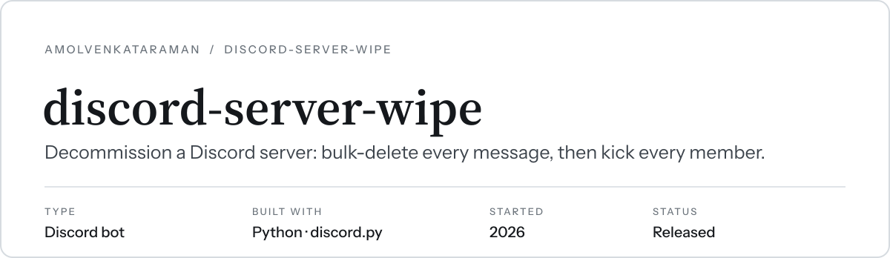

<!-- header:start -->
<div align="center">




[](LICENSE)

[Why](#why-does-it-exist) · [Commands](#commands) · [Setup](#setup)

</div>

<a href="https://haiscale.amolven.com/A1/"></a>
<!-- header:end -->

A self-hosted Discord bot for decommissioning a server: bulk-delete every message, then kick every member. (Formerly NukeBot; the bot still calls itself that in Discord.)

## Why does it exist?

Given the current controversies surrounding Discord, a lot of people are choosing to download their messages locally and delete them from Discord. This bot is meant to help with wiping out servers.

Note that the existence of this bot hinges on the suspicion that Discord is more likely to actually "delete" your messages on their backend if you manually force delete them as opposed to simply removing all members from the server (as evidenced by the fact that deleting older messages is rate limited due to a lack of indexing - deleting a server likely waits some time to delete the actual messages).

The bot also allows for deleting all messages in one channel, or deleting all messages from a specific user.

## Commands

Both commands are restricted to server administrators and ask for confirmation before doing anything.

| Command | Description |
|---------|-------------|
| `/nuke` | Delete every message on the server. Optional `channel` and `user` filters. Picking no filters wipes ALL channels. |
| `/nukefinish` | Kick every member from the server (the owner can't be kicked and is skipped), then the bot leaves. |

## Setup

Getting Discord's approval for a public bot with privileged intents takes a long time, so there is no hosted version. You run your own copy:

1. **Create the bot.** In the [Discord Developer Portal](https://discord.com/developers/applications), create an application, open **Bot**, and copy its token. On the same page, turn on the **Server Members** and **Message Content** privileged intents.
2. **Invite it.** Under **OAuth2 → URL Generator**, tick the `bot` and `applications.commands` scopes and the **Administrator** permission, then open the generated URL and add the bot to your server. Move the bot's role above every member it should be able to kick.
3. **Configure.**
   ```bash
   git clone https://github.com/amolvenkataraman/discord-server-wipe.git
   cd discord-server-wipe
   cp .env.example .env   # set DISCORD_TOKEN; optionally GUILD_ID
   ```
   Setting `GUILD_ID` to your server's ID makes the slash commands appear instantly. Without it they sync globally, which can take up to an hour.
4. **Run.**
   ```bash
   python3 -m venv .venv && source .venv/bin/activate
   pip install -r requirements.txt
   python bot.py
   ```
   Keep it running until the wipe finishes. Deleting messages older than 14 days is rate limited by Discord, so a large server can take hours.

Export anything you want to keep first (for example with [DiscordChatExporter](https://github.com/Tyrrrz/DiscordChatExporter)). Deleted messages can't be recovered.

## License

MIT, see [LICENSE](LICENSE).
